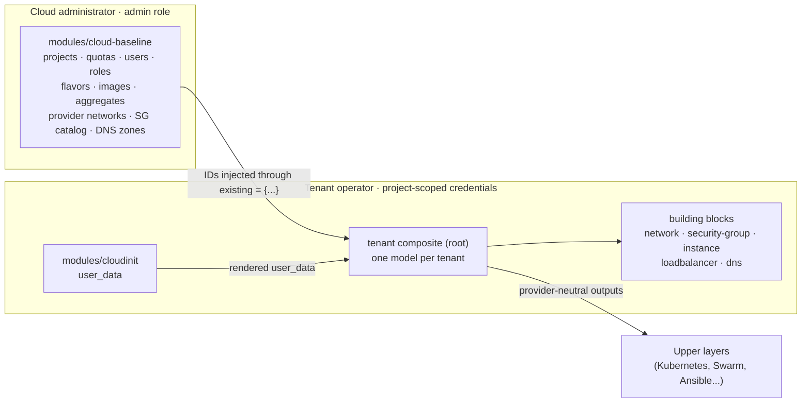

# terraform-openstack-tenant

[](https://github.com/CyprisTech/terraform-openstack-tenant/actions/workflows/ci.yml)
[](LICENSE)
[](https://opentofu.org)
[](https://www.terraform.io)

OpenTofu and Terraform modules that describe an **OpenStack tenant in a single declarative model**, on any OpenStack cloud, public or private, without admin rights: networks, routers, security groups, instances, volumes, floating IPs, Octavia load balancers and Designate DNS. Objects created elsewhere (shared networks, security group catalogs, DNS zones, volumes) can be **adopted** instead of recreated.

> [!WARNING]
> **Pre-release.** The tenant layers of `v0.1.0` are implemented on `main` and tested with mocked providers on OpenTofu and Terraform; tests on real clouds are pending (see [Roadmap](#roadmap)). The interface may still change until `v0.1.0`. Do not use it in production yet.

## Table of contents

- [Features](#features)
- [How it works](#how-it-works)
- [Usage](#usage)
- [Examples](#examples)
- [Requirements and compatibility](#requirements-and-compatibility)
- [Operating the module](#operating-the-module)
- [Versioning and support](#versioning-and-support)
- [Roadmap](#roadmap)
- [Reference](#reference)
- [Contributing](#contributing)
- [Security](#security)
- [License](#license)

## Features

| Area | Capabilities |
|---|---|
| **Projects** | Quotas (compute, network, block storage), role assignments to users or groups |
| **Identity** | Users with generated, provided or no password; groups; application credentials |
| **Networking** | Tenant networks and subnets, allocation pools, host routes, several routers per network with fixed IPs and advertised routes, provider and shared networks (admin) |
| **Security groups** | Rules keyed by name, a shared catalog with explicit RBAC targets |
| **Compute** | Instances from image or volume, named ports on any number of networks, server groups (anti-affinity), data volumes, labels and metadata |
| **Adoption** | Existing networks, subnets, security groups, DNS zones, boot and data volumes |
| **Load balancing** | Octavia load balancers, listeners, pools, members, health monitors, Octavia flavors (topology), floating IP |
| **DNS** | Designate zones owned by a tenant or shared with several, records on ports and floating IPs, free-form records |
| **Bootstrap** | Cloud-init rendering as a separate module; data disks formatted only when empty and mounted by label at every boot |
| **Composition** | Building blocks usable alone; a provider-neutral output contract for upper layers |

## How it works

The repository has three layers. **Building blocks** handle one concern each and can be used alone; the **tenant composite** describes a whole tenant in one model and calls them; **cloud-baseline** handles what requires cloud administrator privileges:



Three principles drive the design (details in [docs/architecture.md](docs/architecture.md)):

1. **One plan, no `-target`.** Every resource is keyed by a name from the input, never by an ID computed at apply time. A new project plans in one pass, and the plan after `apply` is empty.
2. **Adopt by injection.** Objects owned by another stack are passed to `existing` by ID (or looked up by name when they already exist), so even objects created in the same apply can be adopted.
3. **Least privilege.** Tenant layers run with a member role on their project and never need to read other projects.
4. **No operational opinion.** The modules contain no backend, no provider configuration and no dependency on a secret store or CI system. See [Operating the module](#operating-the-module).

## Usage

> [!NOTE]
> Pin a release with `?ref=` once `v0.1.0` is published.

With credentials scoped to the project (a member role is enough):

```hcl
module "tenant" {
  source = "github.com/CyprisTech/terraform-openstack-tenant?ref=v0.1.0"

  tenant = {
    # Resources are created in the project of the provider's credentials.
    existing = { networks = { public = { name = "public", subnets = { v4 = { name = "public-subnet" } } } } }

    networks = {
      app = {
        subnets = { main = { cidr = "192.168.10.0/24" } }
        routers = { out = { external_network = "public", internal_subnet = "main" } } # default gateway of the subnet
      }
    }

    security_groups = {
      web = { rules = { https = { direction = "ingress", protocol = "tcp", port_min = 443, port_max = 443, remote_ip_prefix = "0.0.0.0/0" } } }
    }

    instances = {
      web-1 = {
        flavor = "m1.small", image = "ubuntu-24.04", az = "nova"
        ports = {
          main = { network = "app", subnet = "main", security_groups = ["web"], floating_ip = { pool = "public" } }
        }
      }
    }
  }
}

output "web_ip" {
  value = module.tenant.instances["web-1"].ports["main"].floating_ip
}
```

The provider is configured by the caller, for example with a `clouds.yaml` entry and `OS_CLOUD`:

```hcl
provider "openstack" {
  cloud = "demo"
}
```

The building blocks can also be used directly, without the composite: see [`examples/building-blocks`](examples/building-blocks).

**Cloud administrators** (planned for `v0.2.0`): `modules/cloud-baseline` will create projects, quotas, users, role assignments, flavors, images, provider networks, a shared security group catalog and DNS zones owned by or shared with tenants. Its input model is described in [ADR-0001 § D4](docs/adr/0001-module-design.md#d4-cloud-baseline-input-model).

## Examples

The [examples](examples/README.md) are complete root configurations, validated in CI on both tools:

| Example | Shows |
|---|---|
| [`minimal-no-lb-no-dns`](examples/minimal-no-lb-no-dns) | The smallest useful tenant, on a cloud without Octavia or Designate |
| [`lab-single-stack`](examples/lab-single-stack) | A complete tenant in one stack, with cloud-init, volumes and floating IPs |
| [`adopt-existing`](examples/adopt-existing) | Adoption by ID and by name of networks, security groups, DNS zones and volumes |
| [`layered-network-compute`](examples/layered-network-compute) | Network and compute layers in separate states, connected through `existing` |
| [`public-edge`](examples/public-edge) | Octavia in front of reverse proxies, PROXY protocol, DNS on the floating IP |
| [`building-blocks`](examples/building-blocks) | The building blocks used directly, without the composite |

Every attribute of the model is documented in the [tenant model reference](docs/tenant-model.md).

## Requirements and compatibility

| Component | Supported versions | Tested in CI |
|---|---|---|
| OpenTofu | >= 1.6 | 1.6.3 and latest |
| Terraform | >= 1.6 | 1.6.6 and latest |
| Provider [`terraform-provider-openstack/openstack`](https://registry.terraform.io/providers/terraform-provider-openstack/openstack/latest) | `~> 3.2` from `v0.1.0` (pre-release code: `~> 1.53`) | pinned minimum and latest |
| OpenStack APIs | Keystone v3, Nova, Neutron, Cinder v3, Glance v2; Octavia and Designate optional | Private cloud, OpenStack 2025.1 (all 4 stages passing, see [docs/testing.md](docs/testing.md)); public OpenStack cloud planned; DevStack for `cloud-baseline` |

## Operating the module

State storage, state encryption, locking, the origin of secrets and the delivery pipeline are **your choices**. The modules work the same with a manual `apply` and with a GitOps pipeline. [docs/operations.md](docs/operations.md) lists the points to decide and common options, without prescribing any:

- the state contains generated passwords until the provider supports write-only attributes, so it must be stored and accessed as a secret;
- `sensitive = true` hides values from the CLI output, not from the state;
- do not put secrets in `user_data`: the metadata service exposes it to the whole project.

## Versioning and support

- The project follows [Semantic Versioning](https://semver.org/). Before `v1.0.0`, minor versions may contain breaking changes; they are listed in the [changelog](CHANGELOG.md) with migration notes.
- Pin a version with `?ref=vX.Y.Z` in the module `source`.
- Only the latest minor release receives fixes before `v1.0.0`.

## Roadmap

| Release | Content | Status |
|---|---|---|
| — | Repository skeleton, CI, documentation | done |
| — | Examples and hand-written tenant model reference, as the interface specification | in review |
| **v0.1.0** | Building blocks `network` ✅, `security-group` ✅, `instance` ✅, `loadbalancer` ✅, `dns` ✅; `modules/cloudinit` ✅; tenant composite ✅; output contract ✅; tests on OpenTofu and Terraform, on a private and a public OpenStack cloud | planned |
| **v0.2.0** | `modules/cloud-baseline` (admin level), tested on DevStack | planned |

## Reference

The tables below are generated by [terraform-docs](https://terraform-docs.io). The `tenant` variable is a single nested object: read the [tenant model reference](docs/tenant-model.md) for the meaning of each attribute. Regenerate with `terraform-docs .`.

<!-- BEGIN_TF_DOCS -->
### Requirements

| Name | Version |
| ---- | ------- |
| <a name="requirement_terraform"></a> [terraform](#requirement\_terraform) | >= 1.6 |
| <a name="requirement_openstack"></a> [openstack](#requirement\_openstack) | ~> 3.2 |

### Providers

| Name | Version |
| ---- | ------- |
| <a name="provider_openstack"></a> [openstack](#provider\_openstack) | ~> 3.2 |

### Modules

| Name | Source | Version |
| ---- | ------ | ------- |
| <a name="module_dns"></a> [dns](#module\_dns) | ./modules/dns | n/a |
| <a name="module_instance"></a> [instance](#module\_instance) | ./modules/instance | n/a |
| <a name="module_loadbalancer"></a> [loadbalancer](#module\_loadbalancer) | ./modules/loadbalancer | n/a |
| <a name="module_network"></a> [network](#module\_network) | ./modules/network | n/a |
| <a name="module_security_group"></a> [security\_group](#module\_security\_group) | ./modules/security-group | n/a |

### Resources

| Name | Type |
| ---- | ---- |
| [openstack_compute_servergroup_v2.this](https://registry.terraform.io/providers/terraform-provider-openstack/openstack/latest/docs/resources/compute_servergroup_v2) | resource |
| [openstack_networking_secgroup_rule_v2.cross_group](https://registry.terraform.io/providers/terraform-provider-openstack/openstack/latest/docs/resources/networking_secgroup_rule_v2) | resource |
| [openstack_dns_zone_v2.existing](https://registry.terraform.io/providers/terraform-provider-openstack/openstack/latest/docs/data-sources/dns_zone_v2) | data source |
| [openstack_networking_network_v2.existing](https://registry.terraform.io/providers/terraform-provider-openstack/openstack/latest/docs/data-sources/networking_network_v2) | data source |
| [openstack_networking_secgroup_v2.existing](https://registry.terraform.io/providers/terraform-provider-openstack/openstack/latest/docs/data-sources/networking_secgroup_v2) | data source |
| [openstack_networking_subnet_v2.existing](https://registry.terraform.io/providers/terraform-provider-openstack/openstack/latest/docs/data-sources/networking_subnet_v2) | data source |

### Inputs

| Name | Description | Type | Default | Required |
| ---- | ----------- | ---- | ------- | :------: |
| <a name="input_tenant"></a> [tenant](#input\_tenant) | Declarative model of the tenant: adopted objects, networks, routers,<br/>security groups, instances, load balancers and DNS. Every collection is<br/>a map keyed by name; objects reference each other by key.<br/>See docs/tenant-model.md for the meaning of every attribute. | <pre>object({<br/>    # Objects owned elsewhere, adopted by ID (may be created in the same apply)<br/>    # or by name (looked up at plan time, must exist). DNS zones always need<br/>    # their name, which builds record names; their ID is optional.<br/>    existing = optional(object({<br/>      networks = optional(map(object({<br/>        id      = optional(string)<br/>        name    = optional(string)<br/>        subnets = optional(map(object({ id = optional(string), name = optional(string) })), {})<br/>      })), {})<br/>      security_groups = optional(map(object({ id = optional(string), name = optional(string) })), {})<br/>      dns_zones       = optional(map(object({ id = optional(string), name = string })), {})<br/>    }), {})<br/><br/>    networks = optional(map(object({<br/>      name                    = optional(string) # defaults to the map key<br/>      mtu                     = optional(number)<br/>      admin_state_up          = optional(bool, true)<br/>      availability_zone_hints = optional(list(string), [])<br/>      subnets = map(object({<br/>        cidr             = string<br/>        ip_version       = optional(number, 4)<br/>        gateway_ip       = optional(string)<br/>        enable_dhcp      = optional(bool, true)<br/>        dns_nameservers  = optional(list(string), [])<br/>        allocation_pools = optional(list(object({ start = string, end = string })), [])<br/>        host_routes      = optional(list(object({ destination = string, nexthop = string })), [])<br/>      }))<br/>      routers = optional(map(object({<br/>        external_network        = string # key in existing.networks<br/>        external_subnet         = optional(string)<br/>        external_ip             = optional(string)<br/>        internal_subnet         = string # key in this network's subnets<br/>        internal_ip             = optional(string)<br/>        default_gateway         = optional(bool)<br/>        advertise_routes        = optional(list(string), [])<br/>        admin_state_up          = optional(bool, true)<br/>        availability_zone_hints = optional(list(string), [])<br/>      })), {})<br/>    })), {})<br/><br/>    security_groups = optional(map(object({<br/>      description = optional(string, "")<br/>      rules = optional(map(object({<br/>        direction        = string # "ingress" or "egress"<br/>        ethertype        = optional(string, "IPv4")<br/>        protocol         = optional(string)<br/>        port_min         = optional(number)<br/>        port_max         = optional(number)<br/>        remote_ip_prefix = optional(string)<br/>        remote_group     = optional(string) # key of a local or existing security group<br/>      })), {})<br/>    })), {})<br/><br/>    # Nova server groups, to spread (or pack) instances across compute hosts.<br/>    server_groups = optional(map(object({<br/>      policy              = optional(string, "anti-affinity") # anti-affinity | affinity | soft-anti-affinity | soft-affinity<br/>      max_server_per_host = optional(number)                  # anti-affinity only<br/>    })), {})<br/><br/>    instances = optional(map(object({<br/>      az        = string<br/>      flavor    = optional(string)<br/>      flavor_id = optional(string)<br/>      image     = optional(string)<br/>      image_id  = optional(string)<br/>      boot = optional(object({<br/>        source      = optional(string, "image") # "image", "volume" or "existing"<br/>        size        = optional(number)<br/>        volume_type = optional(string)<br/>        az          = optional(string) # Cinder availability zone of a created root volume<br/>        id          = optional(string)<br/>        name        = optional(string)<br/>      }), {})<br/>      server_group = optional(string) # key in server_groups<br/>      ports = map(object({<br/>        network         = string<br/>        subnet          = string<br/>        fixed_ip        = optional(string)<br/>        security_groups = optional(list(string), [])<br/>        floating_ip = optional(object({<br/>          pool   = string           # key in existing.networks<br/>          subnet = optional(string) # key in that network's subnets<br/>          dns    = optional(list(object({ name = string, zone = string })), [])<br/>        }))<br/>        dns = optional(list(object({ name = string, zone = string })), [])<br/>      }))<br/>      volumes = optional(map(object({<br/>        size        = optional(number)<br/>        az          = optional(string)<br/>        volume_type = optional(string)<br/>        existing    = optional(object({ id = optional(string), name = optional(string) }))<br/>      })), {})<br/>      user_data = optional(string)<br/>      labels    = optional(list(string), [])<br/>      metadata  = optional(map(string), {})<br/>    })), {})<br/><br/>    load_balancers = optional(map(object({<br/>      vip               = object({ network = string, subnet = string, ip = optional(string) })<br/>      flavor_id         = optional(string) # Octavia flavor: defines the topology (single or active/standby)<br/>      availability_zone = optional(string)<br/>      security_groups   = optional(list(string), [])<br/>      floating_ip = optional(object({<br/>        pool   = string           # key in existing.networks<br/>        subnet = optional(string) # key in that network's subnets<br/>        dns    = optional(list(object({ name = string, zone = string })), [])<br/>      }))<br/>      listeners = map(object({<br/>        protocol      = string<br/>        port          = number<br/>        allowed_cidrs = optional(list(string), [])<br/>        timeouts      = optional(map(number), {})<br/>        pool = object({<br/>          protocol    = string<br/>          method      = optional(string, "ROUND_ROBIN")<br/>          members     = list(string) # "<instance>.<port>"<br/>          member_port = optional(number)<br/>          monitor = optional(object({<br/>            type           = string<br/>            delay          = optional(number, 5)<br/>            timeout        = optional(number, 3)<br/>            max_retries    = optional(number, 3)<br/>            url_path       = optional(string)<br/>            expected_codes = optional(string)<br/>          }))<br/>        })<br/>      }))<br/>    })), {})<br/><br/>    dns = optional(object({<br/>      zones = optional(map(object({<br/>        name        = string<br/>        email       = string<br/>        ttl         = optional(number)<br/>        description = optional(string, "")<br/>      })), {})<br/>      records = optional(map(object({<br/>        zone    = string # key in dns.zones or existing.dns_zones<br/>        name    = string<br/>        type    = string<br/>        records = list(string)<br/>        ttl     = optional(number)<br/>      })), {})<br/>    }), {})<br/><br/>    defaults = optional(object({ ttl = optional(number, 3000) }), {})<br/>  })</pre> | n/a | yes |

### Outputs

| Name | Description |
| ---- | ----------- |
| <a name="output_dns_zones"></a> [dns\_zones](#output\_dns\_zones) | DNS zones created by the module, keyed like the input: { id, name }. |
| <a name="output_instances"></a> [instances](#output\_instances) | Instances keyed like the input: { id, az, labels, ports = { <port> = { ip, floating\_ip, fqdn } } }. |
| <a name="output_load_balancers"></a> [load\_balancers](#output\_load\_balancers) | Load balancers keyed like the input: { id, vip, floating\_ip, fqdns }. |
| <a name="output_networks"></a> [networks](#output\_networks) | Networks created by the module, keyed like the input: { id, subnets = { <subnet> = { id, cidr } }, routers = { <router> = { id, internal\_ip } } }. |
| <a name="output_security_groups"></a> [security\_groups](#output\_security\_groups) | Security groups created by the module, keyed like the input: { id }. |
| <a name="output_server_groups"></a> [server\_groups](#output\_server\_groups) | Server groups keyed like the input: { id, policy }. |
<!-- END_TF_DOCS -->

## Contributing

Contributions are welcome. Read [CONTRIBUTING.md](CONTRIBUTING.md) for the development setup, conventions and review process, and follow the [Code of Conduct](CODE_OF_CONDUCT.md). For questions, see [SUPPORT.md](SUPPORT.md).

## Security

Report vulnerabilities privately, as described in [SECURITY.md](SECURITY.md). Never attach state files, credentials or infrastructure details to issues or pull requests.

## License

Copyright © 2025-2026 Cypris Tech and contributors. Licensed under the [Apache License 2.0](LICENSE).

Maintained by [Gregory Gabrielian](https://github.com/CyprisTech) at [Cypris Tech](https://github.com/CyprisTech).
