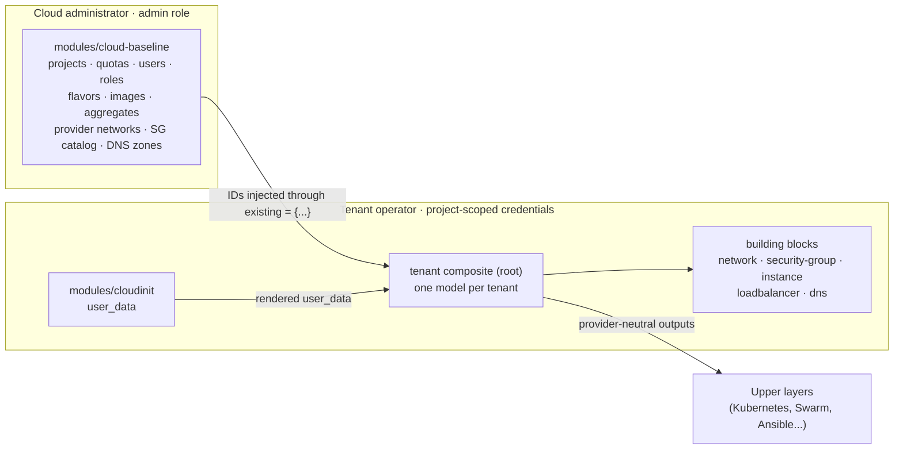

# terraform-openstack-tenant

[](https://github.com/CyprisTech/terraform-openstack-tenant/actions/workflows/ci.yml)
[](LICENSE)
[](https://opentofu.org)
[](https://www.terraform.io)

OpenTofu and Terraform modules that describe an **OpenStack tenant in a single declarative model**: networks, routers, security groups, instances, volumes, floating IPs, Octavia load balancers and Designate DNS. Objects created elsewhere (shared networks, security group catalogs, DNS zones, volumes) can be **adopted** instead of recreated.

> [!WARNING]
> **Pre-release, under redesign.** The code currently on `main` predates the design described in [ADR-0001](docs/adr/0001-module-design.md) and is being rewritten in successive pull requests (see [Roadmap](#roadmap)). Its interface **will change without notice** until `v0.1.0`. Do not use it in production.

## Table of contents

- [Features](#features)
- [How it works](#how-it-works)
- [Usage](#usage)
- [Examples](#examples)
- [Requirements and compatibility](#requirements-and-compatibility)
- [Operating the module](#operating-the-module)
- [Versioning and support](#versioning-and-support)
- [Roadmap](#roadmap)
- [Reference](#reference)
- [Contributing](#contributing)
- [Security](#security)
- [License](#license)

## Features

| Area | Capabilities |
|---|---|
| **Projects** | Quotas (compute, network, block storage), role assignments to users or groups |
| **Identity** | Users with generated, provided or no password; groups; application credentials |
| **Networking** | Tenant networks and subnets, allocation pools, host routes, several routers per network with fixed IPs and advertised routes, provider and shared networks (admin) |
| **Security groups** | Rules keyed by name, a shared catalog with explicit RBAC targets |
| **Compute** | Instances from image or volume, named ports, optional management port on a dedicated network, data volumes, labels and metadata |
| **Adoption** | Existing networks, subnets, security groups, DNS zones, boot and data volumes |
| **Load balancing** | Octavia load balancers, listeners, pools, members, health monitors, topology, floating IP |
| **DNS** | Designate zones, records on ports and floating IPs, free-form records |
| **Bootstrap** | Idempotent cloud-init rendering (disks, mounts, users, packages) as a separate module |
| **Composition** | Building blocks usable alone; a provider-neutral output contract for upper layers |

## How it works

The repository has three layers. **Building blocks** handle one concern each and can be used alone; the **tenant composite** describes a whole tenant in one model and calls them; **cloud-baseline** handles what requires cloud administrator privileges:



Three principles drive the design (details in [docs/architecture.md](docs/architecture.md)):

1. **One plan, no `-target`.** Every resource is keyed by a name from the input, never by an ID computed at apply time. A new project plans in one pass, and the plan after `apply` is empty.
2. **Adopt by injection.** Objects owned by another stack are passed to `existing` by ID (or looked up by name when they already exist), so even objects created in the same apply can be adopted.
3. **Least privilege.** Tenant layers run with a member role on their project and never need to read other projects.
4. **No operational opinion.** The modules contain no backend, no provider configuration and no dependency on a secret store or CI system. See [Operating the module](#operating-the-module).

## Usage

> [!NOTE]
> The examples below show the **target interface of `v0.1.0`** (ADR-0001). They do not work with the pre-release code on `main`.

Cloud administrator, once per cloud:

```hcl
module "baseline" {
  source = "github.com/CyprisTech/terraform-openstack-tenant//modules/cloud-baseline?ref=v0.1.0"

  baseline = {
    projects = {
      demo = { quotas = { compute = { cores = 16, ram = 32768, instances = 8 } } }
    }
    users            = { alice = { email = "alice@example.org" } }   # password generated
    role_assignments = { alice-demo = { user = "alice", project = "demo", role = "member" } }
    networks = {
      transit = {
        external = true, physnet = "physnet1", type = "flat"
        subnets  = { site-a = { cidr = "10.10.0.0/22" } }
      }
    }
  }
}
```

Tenant operator, with credentials scoped to the project:

```hcl
module "tenant" {
  source = "github.com/CyprisTech/terraform-openstack-tenant?ref=v0.1.0"

  tenant = {
    # resources are created in the project of the provider's credentials
    existing = { networks = { transit = { name = "transit", subnets = { site-a = { name = "site-a" } } } } }

    networks = {
      app = {
        subnets = { main = { cidr = "192.168.10.0/24" } }
        routers = { out = { external_network = "transit", internal_subnet = "main" } }
      }
    }

    security_groups = {
      web = { rules = { https = { direction = "ingress", protocol = "tcp", port_min = 443, port_max = 443, remote_ip_prefix = "0.0.0.0/0" } } }
    }

    instances = {
      web-1 = {
        flavor = "m1.small", image = "ubuntu-24.04", az = "nova"
        ports  = { main = { network = "app", subnet = "main", security_groups = ["web"] } }
      }
    }
  }
}

output "web_ip" {
  value = module.tenant.instances["web-1"].ports["main"].ip
}
```

The provider is configured by the caller, for example with a `clouds.yaml` entry and `OS_CLOUD`:

```hcl
provider "openstack" {
  cloud = "demo"
}
```

## Examples

Examples are added with the modules they exercise (see [Roadmap](#roadmap)):

| Example | Shows |
|---|---|
| `examples/lab-single-stack` | One stack creating its own project, for labs and evaluation |
| `examples/baseline-plus-tenant` | The two privilege levels, one state each |
| `examples/adopt-existing` | Adoption of shared networks, security groups, zones and volumes |
| `examples/layered-network-compute` | Network and compute layers in separate states, connected through `existing` |
| `examples/building-blocks` | The building blocks used directly, without the composite |
| `examples/public-edge` | Octavia in front of reverse proxies, PROXY protocol, DNS on the floating IP |

## Requirements and compatibility

| Component | Supported versions | Tested in CI |
|---|---|---|
| OpenTofu | >= 1.6 | 1.6.3 and latest |
| Terraform | >= 1.6 | 1.6.6 and latest |
| Provider [`terraform-provider-openstack/openstack`](https://registry.terraform.io/providers/terraform-provider-openstack/openstack/latest) | `~> 3.0` from `v0.1.0` (pre-release code: `~> 1.53`) | pinned minimum and latest |
| OpenStack APIs | Keystone v3, Nova, Neutron, Cinder v3, Glance v2; Octavia and Designate optional | DevStack (integration tests, planned) |

## Operating the module

State storage, state encryption, locking, the origin of secrets and the delivery pipeline are **your choices**. The modules work the same with a manual `apply` and with a GitOps pipeline. [docs/operations.md](docs/operations.md) lists the points to decide and common options, without prescribing any:

- the state contains generated passwords until the provider supports write-only attributes, so it must be stored and accessed as a secret;
- `sensitive = true` hides values from the CLI output, not from the state;
- do not put secrets in `user_data`: the metadata service exposes it to the whole project.

## Versioning and support

- The project follows [Semantic Versioning](https://semver.org/). Before `v1.0.0`, minor versions may contain breaking changes; they are listed in the [changelog](CHANGELOG.md) with migration notes.
- Pin a version with `?ref=vX.Y.Z` in the module `source`.
- Only the latest minor release receives fixes before `v1.0.0`.

## Roadmap

| Step | Content | Status |
|---|---|---|
| 1 | Repository skeleton, CI, documentation | in review |
| 2 | `modules/cloud-baseline` with mocked tests | planned |
| 3 | Building blocks `network` and `security-group`, adoption by injection | planned |
| 4 | Building block `instance`: ports, management port, volumes, floating IPs, DNS | planned |
| 5 | `modules/cloudinit` | planned |
| 6 | Load balancers and DNS | planned |
| 7 | Tenant composite, output contract, examples, single-plan and empty-plan tests on both tools | planned |
| 8 | Documentation pass, `v0.1.0` | planned |

## Reference

The tables below are generated by [terraform-docs](https://terraform-docs.io) from the code on `main` (pre-release interface). Regenerate with `terraform-docs .`.

<!-- BEGIN_TF_DOCS -->
### Requirements

| Name | Version |
| ---- | ------- |
| <a name="requirement_openstack"></a> [openstack](#requirement\_openstack) | ~> 1.53.0 |

### Providers

| Name | Version |
| ---- | ------- |
| <a name="provider_openstack"></a> [openstack](#provider\_openstack) | ~> 1.53.0 |

### Resources

| Name | Type |
| ---- | ---- |
| [openstack_blockstorage_quotaset_v3.quota](https://registry.terraform.io/providers/terraform-provider-openstack/openstack/latest/docs/resources/blockstorage_quotaset_v3) | resource |
| [openstack_blockstorage_volume_v3.volumes-data](https://registry.terraform.io/providers/terraform-provider-openstack/openstack/latest/docs/resources/blockstorage_volume_v3) | resource |
| [openstack_blockstorage_volume_v3.volumes-root](https://registry.terraform.io/providers/terraform-provider-openstack/openstack/latest/docs/resources/blockstorage_volume_v3) | resource |
| [openstack_compute_aggregate_v2.aggregate](https://registry.terraform.io/providers/terraform-provider-openstack/openstack/latest/docs/resources/compute_aggregate_v2) | resource |
| [openstack_compute_flavor_v2.flavors](https://registry.terraform.io/providers/terraform-provider-openstack/openstack/latest/docs/resources/compute_flavor_v2) | resource |
| [openstack_compute_instance_v2.nodes](https://registry.terraform.io/providers/terraform-provider-openstack/openstack/latest/docs/resources/compute_instance_v2) | resource |
| [openstack_compute_quotaset_v2.quota](https://registry.terraform.io/providers/terraform-provider-openstack/openstack/latest/docs/resources/compute_quotaset_v2) | resource |
| [openstack_compute_volume_attach_v2.attachments](https://registry.terraform.io/providers/terraform-provider-openstack/openstack/latest/docs/resources/compute_volume_attach_v2) | resource |
| [openstack_dns_recordset_v2.ha_fip_recordset](https://registry.terraform.io/providers/terraform-provider-openstack/openstack/latest/docs/resources/dns_recordset_v2) | resource |
| [openstack_dns_recordset_v2.instance_fip_recordset](https://registry.terraform.io/providers/terraform-provider-openstack/openstack/latest/docs/resources/dns_recordset_v2) | resource |
| [openstack_dns_recordset_v2.instance_port_recordset](https://registry.terraform.io/providers/terraform-provider-openstack/openstack/latest/docs/resources/dns_recordset_v2) | resource |
| [openstack_dns_zone_v2.zone](https://registry.terraform.io/providers/terraform-provider-openstack/openstack/latest/docs/resources/dns_zone_v2) | resource |
| [openstack_identity_project_v3.projects](https://registry.terraform.io/providers/terraform-provider-openstack/openstack/latest/docs/resources/identity_project_v3) | resource |
| [openstack_identity_role_assignment_v3.user_project_roles](https://registry.terraform.io/providers/terraform-provider-openstack/openstack/latest/docs/resources/identity_role_assignment_v3) | resource |
| [openstack_identity_user_v3.users](https://registry.terraform.io/providers/terraform-provider-openstack/openstack/latest/docs/resources/identity_user_v3) | resource |
| [openstack_images_image_v2.images](https://registry.terraform.io/providers/terraform-provider-openstack/openstack/latest/docs/resources/images_image_v2) | resource |
| [openstack_lb_listener_v2.haproxy_listener](https://registry.terraform.io/providers/terraform-provider-openstack/openstack/latest/docs/resources/lb_listener_v2) | resource |
| [openstack_lb_loadbalancer_v2.haproxy](https://registry.terraform.io/providers/terraform-provider-openstack/openstack/latest/docs/resources/lb_loadbalancer_v2) | resource |
| [openstack_lb_member_v2.haproxy_pool_member](https://registry.terraform.io/providers/terraform-provider-openstack/openstack/latest/docs/resources/lb_member_v2) | resource |
| [openstack_lb_monitor_v2.monitor_http_pool](https://registry.terraform.io/providers/terraform-provider-openstack/openstack/latest/docs/resources/lb_monitor_v2) | resource |
| [openstack_lb_pool_v2.haproxy_pool](https://registry.terraform.io/providers/terraform-provider-openstack/openstack/latest/docs/resources/lb_pool_v2) | resource |
| [openstack_networking_floatingip_associate_v2.ha_fip_association](https://registry.terraform.io/providers/terraform-provider-openstack/openstack/latest/docs/resources/networking_floatingip_associate_v2) | resource |
| [openstack_networking_floatingip_associate_v2.instance_fip_association](https://registry.terraform.io/providers/terraform-provider-openstack/openstack/latest/docs/resources/networking_floatingip_associate_v2) | resource |
| [openstack_networking_floatingip_v2.ha_floating_ip](https://registry.terraform.io/providers/terraform-provider-openstack/openstack/latest/docs/resources/networking_floatingip_v2) | resource |
| [openstack_networking_floatingip_v2.instance_floating_ip](https://registry.terraform.io/providers/terraform-provider-openstack/openstack/latest/docs/resources/networking_floatingip_v2) | resource |
| [openstack_networking_network_v2.networks](https://registry.terraform.io/providers/terraform-provider-openstack/openstack/latest/docs/resources/networking_network_v2) | resource |
| [openstack_networking_port_v2.ports](https://registry.terraform.io/providers/terraform-provider-openstack/openstack/latest/docs/resources/networking_port_v2) | resource |
| [openstack_networking_port_v2.provisioning](https://registry.terraform.io/providers/terraform-provider-openstack/openstack/latest/docs/resources/networking_port_v2) | resource |
| [openstack_networking_port_v2.router-port](https://registry.terraform.io/providers/terraform-provider-openstack/openstack/latest/docs/resources/networking_port_v2) | resource |
| [openstack_networking_quota_v2.quota](https://registry.terraform.io/providers/terraform-provider-openstack/openstack/latest/docs/resources/networking_quota_v2) | resource |
| [openstack_networking_rbac_policy_v2.common_secgroup_share](https://registry.terraform.io/providers/terraform-provider-openstack/openstack/latest/docs/resources/networking_rbac_policy_v2) | resource |
| [openstack_networking_router_interface_v2.router-port-association](https://registry.terraform.io/providers/terraform-provider-openstack/openstack/latest/docs/resources/networking_router_interface_v2) | resource |
| [openstack_networking_router_v2.router](https://registry.terraform.io/providers/terraform-provider-openstack/openstack/latest/docs/resources/networking_router_v2) | resource |
| [openstack_networking_secgroup_rule_v2.sec_rules](https://registry.terraform.io/providers/terraform-provider-openstack/openstack/latest/docs/resources/networking_secgroup_rule_v2) | resource |
| [openstack_networking_secgroup_v2.sec_groups](https://registry.terraform.io/providers/terraform-provider-openstack/openstack/latest/docs/resources/networking_secgroup_v2) | resource |
| [openstack_networking_subnet_route_v2.subnet_routes](https://registry.terraform.io/providers/terraform-provider-openstack/openstack/latest/docs/resources/networking_subnet_route_v2) | resource |
| [openstack_networking_subnet_v2.subnets](https://registry.terraform.io/providers/terraform-provider-openstack/openstack/latest/docs/resources/networking_subnet_v2) | resource |
| [openstack_blockstorage_volume_v3.volumes-data](https://registry.terraform.io/providers/terraform-provider-openstack/openstack/latest/docs/data-sources/blockstorage_volume_v3) | data source |
| [openstack_blockstorage_volume_v3.volumes-root](https://registry.terraform.io/providers/terraform-provider-openstack/openstack/latest/docs/data-sources/blockstorage_volume_v3) | data source |
| [openstack_compute_flavor_v2.flavors](https://registry.terraform.io/providers/terraform-provider-openstack/openstack/latest/docs/data-sources/compute_flavor_v2) | data source |
| [openstack_dns_zone_v2.zone](https://registry.terraform.io/providers/terraform-provider-openstack/openstack/latest/docs/data-sources/dns_zone_v2) | data source |
| [openstack_identity_project_v3.projects](https://registry.terraform.io/providers/terraform-provider-openstack/openstack/latest/docs/data-sources/identity_project_v3) | data source |
| [openstack_identity_role_v3.by_name](https://registry.terraform.io/providers/terraform-provider-openstack/openstack/latest/docs/data-sources/identity_role_v3) | data source |
| [openstack_networking_network_v2.network](https://registry.terraform.io/providers/terraform-provider-openstack/openstack/latest/docs/data-sources/networking_network_v2) | data source |
| [openstack_networking_secgroup_v2.sec_groups](https://registry.terraform.io/providers/terraform-provider-openstack/openstack/latest/docs/data-sources/networking_secgroup_v2) | data source |
| [openstack_networking_subnet_v2.subnet](https://registry.terraform.io/providers/terraform-provider-openstack/openstack/latest/docs/data-sources/networking_subnet_v2) | data source |

### Inputs

| Name | Description | Type | Default | Required |
| ---- | ----------- | ---- | ------- | :------: |
| <a name="input_auth_url"></a> [auth\_url](#input\_auth\_url) | Authentication URL for OpenStack | `string` | n/a | yes |
| <a name="input_password"></a> [password](#input\_password) | OpenStack admin password | `string` | n/a | yes |
| <a name="input_region"></a> [region](#input\_region) | OpenStack region | `string` | n/a | yes |
| <a name="input_user_name"></a> [user\_name](#input\_user\_name) | OpenStack admin user | `string` | n/a | yes |
| <a name="input_cloud_init_common"></a> [cloud\_init\_common](#input\_cloud\_init\_common) | Common cloud init user data for tenant instances | <pre>object({<br/>    runcmd      = optional(list(any))<br/>    users       = optional(list(any))<br/>    packages    = optional(list(any))<br/>    network     = optional(any)<br/>    write_files = optional(list(any))<br/>  })</pre> | `{}` | no |
| <a name="input_compute_aggregates"></a> [compute\_aggregates](#input\_compute\_aggregates) | List of compute aggregates to create | <pre>list(object({<br/>    name  = string<br/>    zone  = string<br/>    hosts = list(string)<br/>  }))</pre> | `[]` | no |
| <a name="input_data"></a> [data](#input\_data) | Data structure containing networks | <pre>object({<br/>    networks = list(object({<br/>      name    = string<br/>      subnets = list(string)<br/>    }))<br/>    projects      = list(string)<br/>    project_zones = list(string)<br/>    flavors       = list(string)<br/>    security_groups = list(object({<br/>      name = string<br/>      id   = optional(string)<br/>    }))<br/>  })</pre> | <pre>{<br/>  "flavors": [<br/>    "vcpu1_ram1G_nodisk",<br/>    "vcpu2_ram2G_nodisk",<br/>    "vcpu2_ram4G_nodisk",<br/>    "vcpu4_ram4G_nodisk",<br/>    "vcpu4_ram8G_nodisk"<br/>  ],<br/>  "networks": [<br/>    {<br/>      "name": "monitoring",<br/>      "subnets": [<br/>        "monitoring"<br/>      ]<br/>    },<br/>    {<br/>      "name": "provisioning",<br/>      "subnets": [<br/>        "provisioning"<br/>      ]<br/>    },<br/>    {<br/>      "name": "intranet",<br/>      "subnets": [<br/>        "intranet_site_a"<br/>      ]<br/>    },<br/>    {<br/>      "name": "site_a_provider",<br/>      "subnets": [<br/>        "site_a_provider"<br/>      ]<br/>    },<br/>    {<br/>      "name": "svc_public",<br/>      "subnets": [<br/>        "svc_public_site_a"<br/>      ]<br/>    }<br/>  ],<br/>  "project_zones": [],<br/>  "projects": [],<br/>  "security_groups": []<br/>}</pre> | no |
| <a name="input_dns_records"></a> [dns\_records](#input\_dns\_records) | List of DNS records | `list(any)` | `[]` | no |
| <a name="input_flavors"></a> [flavors](#input\_flavors) | List of flavors to create | <pre>list(object({<br/>    name  = string<br/>    ram   = number<br/>    vcpus = number<br/>    disk  = number<br/>  }))</pre> | `[]` | no |
| <a name="input_haproxy"></a> [haproxy](#input\_haproxy) | HAProxy configuration | <pre>list(object({<br/>    name            = string<br/>    az              = string<br/>    vip_net_name    = string<br/>    vip_subnet_name = string<br/>    fip_pool_name   = string<br/>    fip_subnet_name = string<br/>    listeners = list(object({<br/>      name             = string<br/>      protocol         = string<br/>      port             = number<br/>      dns_record_names = optional(list(string))<br/>      pool = object({<br/>        protocol  = string<br/>        lb_method = string<br/>        monitor = object({<br/>          type        = string<br/>          delay       = number<br/>          timeout     = number<br/>          max_retries = number<br/>        })<br/>        instance_names = list(string)<br/>      })<br/>    }))<br/>  }))</pre> | `[]` | no |
| <a name="input_images"></a> [images](#input\_images) | Images to import into Glance | <pre>list(object({<br/>    name             = string<br/>    image_source_url = string<br/>    container_format = string<br/>    disk_format      = string<br/>  }))</pre> | `[]` | no |
| <a name="input_instances"></a> [instances](#input\_instances) | List of instances configuration | <pre>list(object({<br/>    name              = string<br/>    az                = string<br/>    flavor            = string<br/>    image             = optional(string)<br/>    enable_admin_port = bool<br/>    admin_port_egress = optional(bool, false)<br/>    ports = list(object({<br/>      name                 = string<br/>      network_name         = string<br/>      subnet_name          = string<br/>      security_group_names = list(string)<br/>      fip_pool_name        = optional(string)<br/>      fip_subnet_name      = optional(string)<br/>      fip_dns_records = optional(list(object({<br/>        name = string<br/>        zone = string<br/>      })))<br/>      dns_records = optional(list(object({<br/>        name = string<br/>        zone = string<br/>      })))<br/>    }))<br/>    root_volume = optional(object({<br/>      name   = string<br/>      size   = number<br/>      az     = string<br/>      image  = string<br/>      create = bool<br/>    }))<br/>    data_volumes = list(object({<br/>      name       = string<br/>      size       = number<br/>      az         = string<br/>      mountpoint = optional(string)<br/>      username   = optional(string)<br/>      uid        = optional(string)<br/>      gid        = optional(string)<br/>      create     = bool<br/>    }))<br/>    instance_labels = list(string)<br/>    bind_mounts = optional(list(object({<br/>      username           = string<br/>      uid                = string<br/>      gid                = string<br/>      path               = string<br/>      conf_src_file      = optional(string)<br/>      conf_template_file = optional(string)<br/>      template_vars      = optional(map(any))<br/>    })))<br/>    cloud_init = optional(object({<br/>      runcmd      = optional(list(any))<br/>      users       = optional(list(any))<br/>      packages    = optional(list(any))<br/>      network     = optional(any)<br/>      write_files = optional(list(any))<br/>    }))<br/>  }))</pre> | `[]` | no |
| <a name="input_networks"></a> [networks](#input\_networks) | List of networks, subnets, and routers | <pre>list(object({<br/>    admin_state_up = bool<br/>    name           = string<br/>    mtu            = number<br/>    physnet        = optional(string)<br/>    type           = optional(string)<br/>    az_hints       = list(string)<br/>    external       = bool<br/>    subnets = list(object({<br/>      name        = string<br/>      ip_version  = number<br/>      cidr        = string<br/>      nameservers = optional(list(string))<br/>      gateway_ip  = optional(string)<br/>      extra_routes = optional(list(object({<br/>        to  = string<br/>        via = string<br/>      })))<br/>      allocation_pools = optional(list(object({<br/>        start = string<br/>        end   = string<br/>      })))<br/>      routers = optional(list(object({<br/>        name                    = string<br/>        admin_state_up          = bool<br/>        external_network_name   = string<br/>        subnet_name             = string<br/>        availability_zone_hints = list(string)<br/>        ip_address              = string<br/>        subnet_cidr_override    = optional(string)<br/>        subnet_extra_route_to   = optional(string)<br/>      })))<br/>    }))<br/>  }))</pre> | <pre>[<br/>  {<br/>    "admin_state_up": true,<br/>    "az_hints": [<br/>      "site-a-az",<br/>      "site-b-az"<br/>    ],<br/>    "external": false,<br/>    "mtu": 1362,<br/>    "name": "private",<br/>    "subnets": [<br/>      {<br/>        "cidr": "10.20.5.0/24",<br/>        "gateway_ip": "10.20.5.1",<br/>        "ip_version": 4,<br/>        "name": "private",<br/>        "nameservers": [<br/>          "1.1.1.1"<br/>        ],<br/>        "routers": [<br/>          {<br/>            "admin_state_up": true,<br/>            "availability_zone_hints": [<br/>              "site-a-az"<br/>            ],<br/>            "external_network_name": "site_a_provider",<br/>            "ip_address": "10.20.5.10",<br/>            "name": "router-site_a_provider",<br/>            "subnet_name": "site_a_provider"<br/>          },<br/>          {<br/>            "admin_state_up": true,<br/>            "availability_zone_hints": [<br/>              "site-a-az"<br/>            ],<br/>            "external_network_name": "intranet",<br/>            "ip_address": "10.20.5.11",<br/>            "name": "router-intranet_site_a",<br/>            "subnet_extra_route_to": "10.10.0.0/22",<br/>            "subnet_name": "intranet_site_a"<br/>          },<br/>          {<br/>            "admin_state_up": true,<br/>            "availability_zone_hints": [<br/>              "site-a-az"<br/>            ],<br/>            "external_network_name": "svc_public",<br/>            "ip_address": "10.20.5.12",<br/>            "name": "router-svc_public_site_a",<br/>            "subnet_extra_route_to": "10.10.4.0/22",<br/>            "subnet_name": "svc_public_site_a"<br/>          },<br/>          {<br/>            "admin_state_up": true,<br/>            "availability_zone_hints": [<br/>              "site-b-az"<br/>            ],<br/>            "external_network_name": "site_b_provider",<br/>            "ip_address": "10.20.5.128",<br/>            "name": "router-site_b_provider",<br/>            "subnet_name": "site_b_provider"<br/>          },<br/>          {<br/>            "admin_state_up": true,<br/>            "availability_zone_hints": [<br/>              "site-b-az"<br/>            ],<br/>            "external_network_name": "intranet",<br/>            "ip_address": "10.20.5.129",<br/>            "name": "router-intranet_site_b",<br/>            "subnet_extra_route_to": "10.10.0.0/22",<br/>            "subnet_name": "intranet_site_b"<br/>          },<br/>          {<br/>            "admin_state_up": true,<br/>            "availability_zone_hints": [<br/>              "site-b-az"<br/>            ],<br/>            "external_network_name": "svc_public",<br/>            "ip_address": "10.20.5.130",<br/>            "name": "router-svc_public_site_b",<br/>            "subnet_extra_route_to": "10.10.4.0/22",<br/>            "subnet_name": "svc_public_site_b"<br/>          }<br/>        ]<br/>      }<br/>    ]<br/>  }<br/>]</pre> | no |
| <a name="input_project_zones"></a> [project\_zones](#input\_project\_zones) | Zone to create into the project | <pre>list(object({<br/>    name        = string<br/>    email       = string<br/>    description = string<br/>    ttl         = number<br/>  }))</pre> | `[]` | no |
| <a name="input_projects"></a> [projects](#input\_projects) | List of OpenStack projects | <pre>list(object({<br/>    name        = string<br/>    description = string<br/>    enabled     = bool<br/>  }))</pre> | `[]` | no |
| <a name="input_quotas"></a> [quotas](#input\_quotas) | Network, Compute and Storage quotas | <pre>list(object({<br/>    project_name = string<br/>    compute = optional(object({<br/>      ram       = optional(number)<br/>      cores     = optional(number)<br/>      instances = optional(number)<br/>    }))<br/>    network = optional(object({<br/>      floatingip          = optional(number)<br/>      network             = optional(number)<br/>      subnet              = optional(number)<br/>      port                = optional(number)<br/>      router              = optional(number)<br/>      security_group      = optional(number)<br/>      security_group_rule = optional(number)<br/>      rbac_policy         = optional(number)<br/>    }))<br/>    volume = optional(object({<br/>      volumes              = optional(number)<br/>      snapshots            = optional(number)<br/>      per_volume_gigabytes = optional(number)<br/>      gigabytes            = optional(number)<br/>      backups              = optional(number)<br/>      backup_gigabytes     = optional(number)<br/>    }))<br/>  }))</pre> | `[]` | no |
| <a name="input_security_groups"></a> [security\_groups](#input\_security\_groups) | List of security groups to create | <pre>list(object({<br/>    name        = string<br/>    description = string<br/>    rules = list(object({<br/>      protocol         = optional(string)<br/>      direction        = string<br/>      ethertype        = string<br/>      port_min         = optional(number)<br/>      port_max         = optional(number)<br/>      remote_ip_prefix = string<br/>    }))<br/>  }))</pre> | `[]` | no |
| <a name="input_ssh_user"></a> [ssh\_user](#input\_ssh\_user) | Tenant admin user for VM instances | `string` | `""` | no |
| <a name="input_user_project_roles"></a> [user\_project\_roles](#input\_user\_project\_roles) | Mapping of users to projects and roles | <pre>list(object({<br/>    user    = string<br/>    project = string<br/>    role    = string<br/>  }))</pre> | `[]` | no |
| <a name="input_users"></a> [users](#input\_users) | List of users to create | <pre>list(object({<br/>    name     = string<br/>    password = string<br/>    email    = string<br/>    enabled  = string<br/>  }))</pre> | `[]` | no |

### Outputs

| Name | Description |
| ---- | ----------- |
| <a name="output_cloud_config"></a> [cloud\_config](#output\_cloud\_config) | n/a |
| <a name="output_flavors_created"></a> [flavors\_created](#output\_flavors\_created) | n/a |
| <a name="output_host_bind_mounts"></a> [host\_bind\_mounts](#output\_host\_bind\_mounts) | n/a |
| <a name="output_host_volume_mountpoint"></a> [host\_volume\_mountpoint](#output\_host\_volume\_mountpoint) | n/a |
| <a name="output_instance_details"></a> [instance\_details](#output\_instance\_details) | n/a |
| <a name="output_network_ids"></a> [network\_ids](#output\_network\_ids) | n/a |
| <a name="output_private_networks"></a> [private\_networks](#output\_private\_networks) | n/a |
| <a name="output_runcmd_init_volume"></a> [runcmd\_init\_volume](#output\_runcmd\_init\_volume) | n/a |
| <a name="output_security_groups_created"></a> [security\_groups\_created](#output\_security\_groups\_created) | n/a |
| <a name="output_subnet_ids"></a> [subnet\_ids](#output\_subnet\_ids) | n/a |
| <a name="output_users_created"></a> [users\_created](#output\_users\_created) | n/a |
| <a name="output_volumes_devices"></a> [volumes\_devices](#output\_volumes\_devices) | n/a |
<!-- END_TF_DOCS -->

## Contributing

Contributions are welcome. Read [CONTRIBUTING.md](CONTRIBUTING.md) for the development setup, conventions and review process, and follow the [Code of Conduct](CODE_OF_CONDUCT.md). For questions, see [SUPPORT.md](SUPPORT.md).

## Security

Report vulnerabilities privately, as described in [SECURITY.md](SECURITY.md). Never attach state files, credentials or infrastructure details to issues or pull requests.

## License

Copyright © 2025-2026 Cypris Tech and contributors. Licensed under the [Apache License 2.0](LICENSE).

Maintained by [Gregory Gabrielian](https://github.com/CyprisTech) at [Cypris Tech](https://github.com/CyprisTech).
