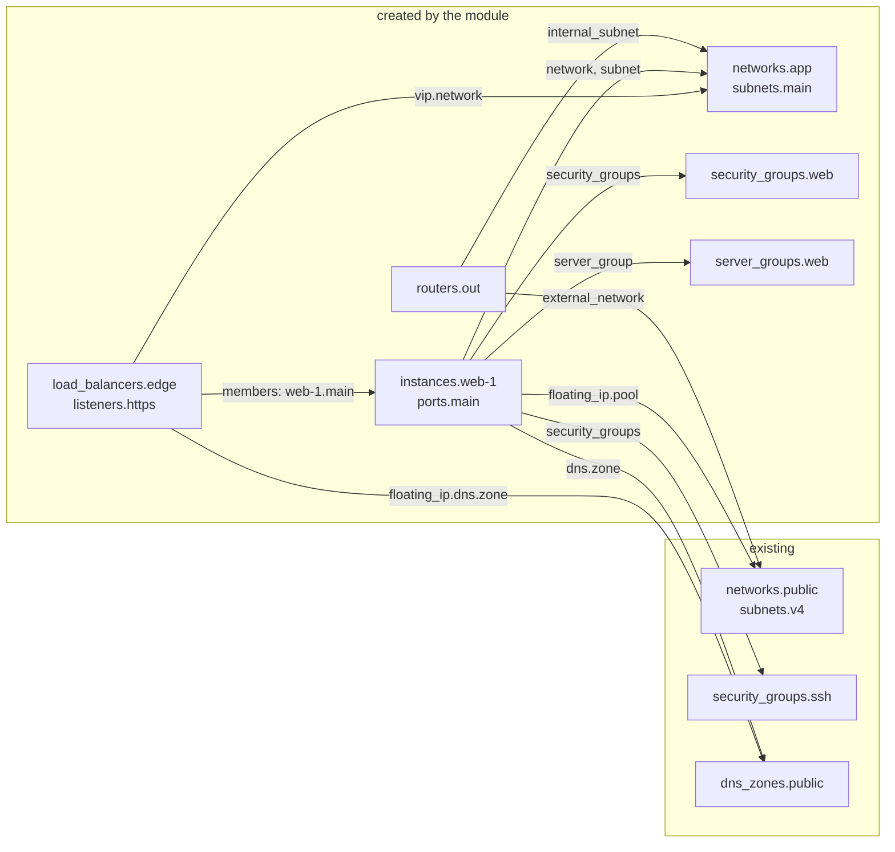

# Architecture

This document explains how the modules are organised and the rules that make them predictable. The decisions behind it are recorded in [ADR-0001](adr/0001-module-design.md).

## Three layers

| | Building blocks | Tenant composite | `modules/cloud-baseline` (planned, `v0.2.0`) |
|---|---|---|---|
| **Path** | `modules/network`, `security-group`, `instance`, `loadbalancer`, `dns` | repository root | `modules/cloud-baseline` |
| **Credentials** | Scoped to one project | Scoped to one project | Cloud `admin` role |
| **Interface** | Small, one concern | One object describing the tenant | One object describing the cloud baseline |
| **Manages** | One kind of resource and what it strictly needs | Everything inside a project, by calling the building blocks | Projects, quotas, users, groups, role assignments, aggregates, flavors, images, provider and shared networks, shared security group catalog, DNS zones |
| **Use it when** | You want your own split or only part of the features | You want one model per tenant | You administer the cloud |

The split follows the usual criteria for Terraform modules: **encapsulation** (one concern per building block), **privileges** (admin versus project) and **volatility** (long-lived networks versus short-lived instances can live in separate states, see below).

The composite never creates its project: Nova creates instances only in the project of the token. Projects, quotas and role assignments belong to `cloud-baseline`; until it ships, they come from the cloud operator and are used as they are.

## The input model

Each module takes **one object** describing the desired state. Collections are **maps keyed by name**:

```hcl
instances = {
  web-1 = { ... }   # the key "web-1" identifies the instance everywhere
  web-2 = { ... }
}
```

Compared with lists, maps mean that adding or removing an element never shifts the others, and that every resource address (`openstack_compute_instance_v2.this["web-1"]`) is known before apply. The full models are in [ADR-0001 § D3](adr/0001-module-design.md#d3-tenant-input-model).

Objects reference each other **by key**: a port names its `network` and `subnet`, a router names its `external_network`, a load balancer pool lists `members` as `"<instance>.<port>"`. Validation rules reject references to keys that do not exist.



Every arrow is a key written in the input. The composite turns keys into IDs (`local.network_ids`, `subnet_ids`, `security_group_ids`, `zone_ids`), whether the target was created in this run or adopted.

## Adoption by injection

A tenant usually relies on objects it does not own: shared networks, a security group catalog, DNS zones, sometimes volumes holding data. They are declared under `existing` (or with `existing` on a volume), **by ID or by name** (DNS zones always with their name):

```hcl
existing = {
  networks        = { transit = { id = module.baseline.networks["transit"].id, subnets = { site-a = { id = module.baseline.subnets["transit/site-a"].id } } } }
  security_groups = { ssh = { name = "baseline-ssh" } }
}
```

- **By ID**, nothing is looked up: the object may even be created in the same apply, by `cloud-baseline` or another module of the same root configuration.
- **By name**, a data source resolves the object at plan time: it must already exist.

Adopted and created objects share the same key namespace, so a reference does not need to know where an object comes from.

### Separating volatile layers

Calling the composite twice, once for networks and once for instances, gives each layer its own state. The compute layer adopts the network layer's outputs through `existing`. Changes to instances then never touch the networks' state.

## Least privilege

Tenant layers need only a member role on their project:

- they never list or read projects; resources are created in the project of the provider's credentials;
- DNS records can only be written in zones owned by the project or shared with it. `cloud-baseline` either creates a zone **for** a tenant (`project`) or keeps it and **shares** it (`share_with`). Zones are never transferred after creation: a transfer hides the zone from the stack that created it;
- quotas and role assignments are admin operations, available in `cloud-baseline` only.

## One plan, no `-target`

A configuration whose `for_each` keys depend on values known only after apply cannot be planned in one pass: the tool asks for `-target`. The modules prevent this by construction:

1. `for_each` collections and keys come only from the input.
2. IP addresses and IDs are read from the resource that owns them, never by filtering other resources.
3. Outputs have a fixed shape; absent values are `null`.

The test suite enforces the result on both tools: an empty project plans in one pass, and the plan after `apply` is empty.

## Outputs

Outputs are a stable contract for the layers above (Kubernetes or Swarm bootstrap, configuration management, inventories):

```hcl
module.tenant.instances = {
  web-1 = {
    id     = "..."
    az     = "nova"
    labels = ["edge"]
    ports  = { main = { id = "...", ip = "192.168.10.5", floating_ip = null, floating_ips = {}, fqdn = null } }
  }
}
```

`networks`, `subnets`, `security_groups`, `load_balancers` and `dns_zones` follow the same rule. Consume them through remote state or data sources; the modules contain no SSH provisioner.

The output shape is **provider-neutral** and stable: its attributes, its compatibility rule and what "provider-neutral" means are specified in [ADR-0002](adr/0002-output-contract.md).

## Lifecycle rules

Terraform does not allow `lifecycle` settings to depend on variables, so the modules fix them and document them:

- **`user_data` changes are ignored** on existing instances. To apply a new cloud-init, replace the instance explicitly: `tofu apply -replace='module.tenant.module.instance["web-1"].openstack_compute_instance_v2.this'`.
- **No `prevent_destroy`.** Create volumes that must survive outside the module, protect them with your own `lifecycle { prevent_destroy = true }`, and adopt them with `existing`.

## Instance bootstrap

`user_data` is an input. `modules/cloudinit` renders it from a typed description of users, packages, files, disks and bind mounts. Data volumes are usually attached after the instance has booted, so each disk is handled by a systemd unit that waits for the device, formats it only when it holds no file system, and mounts it by label at every boot. See [the module README](../modules/cloudinit/README.md).

## Implementation map

Where each decision of [ADR-0001](adr/0001-module-design.md) lives in the code:

| Decision | Where |
|---|---|
| One model per tenant, references by key | [`variables.tf`](../variables.tf) (type and validation rules), [`main.tf`](../main.tf) (`local.network_ids`, `subnet_ids`, `security_group_ids`, `zone_ids`, `zone_names`) |
| Adoption by injection (ID) or lookup (name) | `main.tf`: `data "openstack_networking_*" "existing"`, `local.existing_*_ids` |
| No dependency of a module on its own outputs | `main.tf`: adopted-only tables (`local.existing_*`) passed to `module.network` and `module.security_group`; `openstack_networking_secgroup_rule_v2.cross_group` for rules between local groups |
| Stable keys (one plan, no `-target`) | every `for_each` in `modules/*/main.tf` and `main.tf`; DNS keys `<port>/<fixed\|floating>/<name>@<zone_name>` and `<port>/extra-floating/<label>/<name>@<zone_name>`, extra floating IPs `<port>/<label>`, LB members `<listener>/<member>`, host routes `<subnet>/<destination>` |
| Several routers per subnet, default gateway | `modules/network/main.tf`: dedicated router ports, `local.gateway_router` |
| Server groups (anti-affinity) | `main.tf`: `openstack_compute_servergroup_v2.this`, passed to `modules/instance` as `server_group_id` |
| Fixed lifecycle rules | `modules/instance/main.tf`: `ignore_changes = [user_data, image_id, image_name, block_device]`, no `prevent_destroy` |
| Data disks attached after boot | `modules/cloudinit/templates/disk-setup.sh.tftpl` and `unit.service.tftpl` |
| Octavia flavor instead of topology | `modules/loadbalancer`: `flavor_id` |
| DNS zones created for a project | `modules/dns`: `project_id` (sudo header) |
| Provider-neutral output contract | [`outputs.tf`](../outputs.tf) |
| No operational opinion | no `backend` or `provider` block in any module |

## Known limitations

- **No public cloud results yet.** The five integration stages and the `three-tier-ha` example pass on a private OpenStack 2025.1 cloud; on the public test cloud, plans pass and apply waits for network quotas; see [testing](testing.md). No run yet on a cloud without Octavia or Designate.
- **One internal subnet per router.** A router connects one subnet of a network; a single router serving several subnets is not modelled yet (use one router per subnet, or segment tiers with security groups on one subnet, as in [`examples/three-tier-ha`](../examples/three-tier-ha)).
- **TLS termination on Octavia** (`TERMINATED_HTTPS`) needs Barbican container references, not exposed yet; TCP passthrough with the PROXY protocol is supported.
- **One fixed address per port**, IPv4 or IPv6 without router advertisement settings; no ports without a fixed IP.
- **Security group rules between local groups** are created by the composite itself, outside `modules/security-group`; their addresses in the state reflect that.
- **`cloud-baseline` is planned for `v0.2.0`**: until then, projects, quotas, users, shared networks and zones come from elsewhere and are adopted.
- **No write-only attributes yet.** Nothing in the tenant layers stores a secret today; when `cloud-baseline` generates passwords, they will stay in the state until the provider supports write-only attributes (ADR-0001, D6).

Problems that come from the cloud rather than from the module (MTU, source NAT, quotas, DNS delays) are collected in [real-cloud pitfalls](pitfalls.md).

