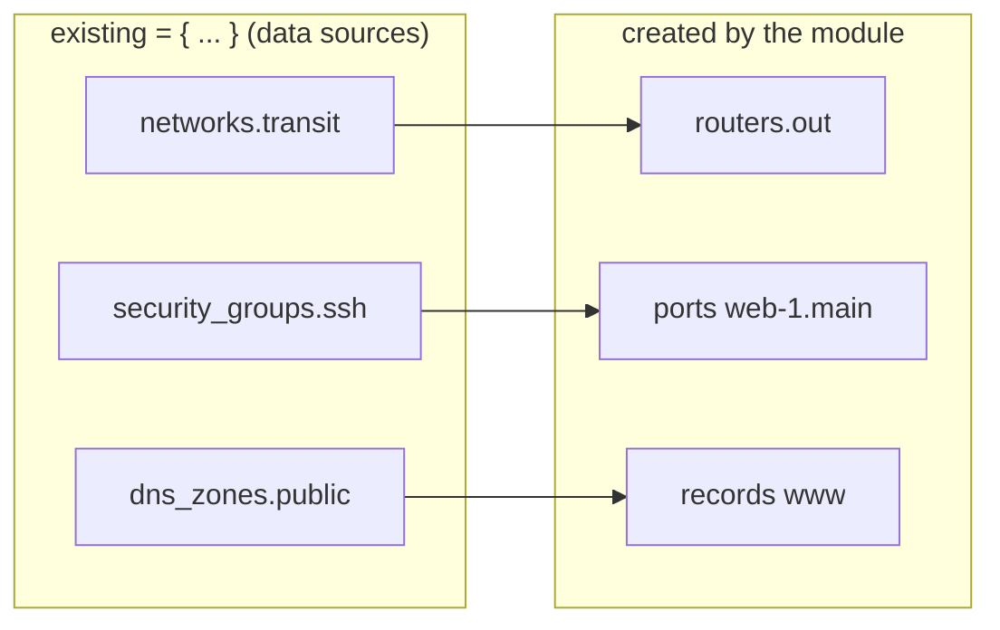

# Architecture

This document explains how the modules are organised and the rules that make them predictable. The decisions behind it are recorded in [ADR-0001](adr/0001-module-design.md).

## Two privilege levels

OpenStack separates what a cloud administrator controls from what a project member controls. The modules follow the same line, so that day-to-day tenant changes never require admin credentials.

| | `modules/cloud-baseline` | Root module (tenant) |
|---|---|---|
| **Credentials** | Cloud `admin` role | Scoped to one project (user or application credential) |
| **Scope** | Whole cloud | One project |
| **Manages** | Projects, quotas, users, groups, role assignments, aggregates, flavors, images, provider and shared networks, shared security group catalog, DNS zones | Networks, subnets, routers, security groups, instances, ports, volumes, floating IPs, load balancers, DNS records |
| **Typical cadence** | Rarely (onboarding, capacity changes) | Often (new instance, new service) |
| **State** | One | One per tenant |

For labs, the tenant module can create its own project (`project.create = true`) and run with admin credentials in a single stack.

## The input model

Each module takes **one object** describing the desired state. Collections are **maps keyed by name**:

```hcl
instances = {
  web-1 = { ... }   # the key "web-1" identifies the instance everywhere
  web-2 = { ... }
}
```

Compared with lists, maps mean that adding or removing an element never shifts the others, and that every resource address (`openstack_compute_instance_v2.this["web-1"]`) is known before apply. The full models are in [ADR-0001 § D2 and D3](adr/0001-module-design.md#d2-tenant-input-model).

Objects reference each other **by key**: a port names its `network` and `subnet`, a router names its `external_network`, a load balancer pool lists `members` as `"<instance>.<port>"`. Validation rules reject references to keys that do not exist.

## Adoption of existing objects

A tenant usually relies on objects it does not own: shared networks, a security group catalog, DNS zones, sometimes volumes holding data. They are declared under `existing` (or with `existing = true` on a volume) and resolved with data sources:



The same key namespace is used for adopted and created objects, so a reference does not need to know where an object comes from. Each key is resolved at plan time to exactly one of the two.

## One plan, no `-target`

A configuration whose `for_each` keys depend on values known only after apply cannot be planned in one pass: the tool asks for `-target`. The modules prevent this by construction:

1. `for_each` collections and keys come only from the input.
2. IP addresses and IDs are read from the resource that owns them, never by filtering other resources.
3. Outputs have a fixed shape; absent values are `null`.

The test suite enforces the result on both tools: an empty project plans in one pass, and the plan after `apply` is empty.

## Outputs

Outputs are a stable contract for the layers above (Kubernetes or Swarm bootstrap, configuration management, inventories):

```hcl
module.tenant.instances = {
  web-1 = {
    id     = "..."
    az     = "nova"
    labels = ["edge"]
    ports  = { main = { ip = "192.168.10.5", floating_ip = null, fqdn = null } }
  }
}
```

`networks`, `subnets`, `security_groups`, `load_balancers` and `dns_zones` follow the same rule. Consume them through remote state or data sources; the modules contain no SSH provisioner.

## Instance bootstrap

`user_data` is an input. `modules/cloudinit-ubuntu` renders it from a typed description of disks, mounts, users and packages, using cloud-init's own idempotent directives (`fs_setup`, `mounts`) rather than shell commands. By default, a change to `user_data` does not replace a running instance (`ignore_user_data_changes = true`).
