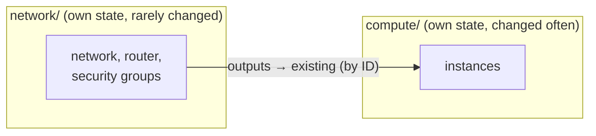

# Layered network and compute

Two root configurations with separate states:

1. `network/`: networks, router, security groups. Long-lived, rarely changed.
2. `compute/`: instances, adopting the network layer's objects by ID.

Changes to instances never touch the network layer's state. The example shares outputs through a local state file to stay self-contained; use the backend of your choice.

```bash
(cd network && tofu init && tofu apply)
(cd compute && tofu init && tofu apply)
```



Destroy in the reverse order: `compute/` first, then `network/`.
