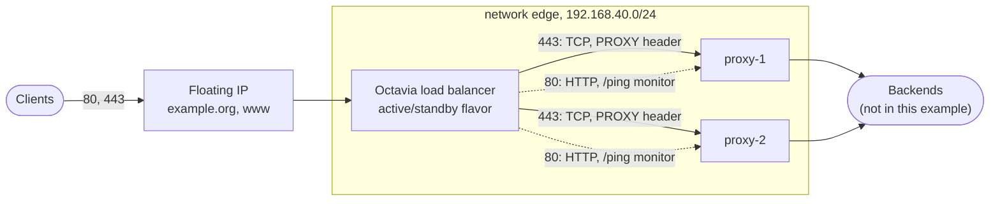

# Public edge

Two reverse proxies behind an Octavia load balancer: the pattern of a public entry point that routes many domains without terminating TLS itself.



| Concern | How |
|---|---|
| Client addresses | Port 443 is TCP passthrough with the **PROXY protocol**: proxies see the client address and terminate TLS themselves (or pass it through by SNI). |
| Health | TCP monitor on 443, HTTP monitor on `/ping` for port 80; a ping would only prove the instance is up. |
| Availability | An Octavia flavor with the active/standby topology (`octavia_flavor_id`); proxies on two hosts (`anti-affinity` server group). |
| Isolation | Proxies accept 80 and 443 only from the network of the load balancer. |
| DNS | A records for the apex and `www` on the floating IP. |

The proxies themselves (configuration, certificates) are out of scope. A complete entry point with Traefik, SNI routing and PROXY v2 to the backends is in [openstack-multitenant-reference](https://github.com/CyprisTech/openstack-multitenant-reference/tree/main/stacks/20-public-edge).

## Run

```bash
export OS_CLOUD=mycloud
openstack loadbalancer flavor list          # pick an active/standby flavor, if the cloud has one
tofu init && tofu apply -var octavia_flavor_id=<id or omit>
```

Adapt `public`, `public-subnet`, `m1.small`, `ubuntu-24.04`, `nova` and the zone `example.org.` (owned by or shared with the project) to your cloud. Requires Octavia and Designate. Output: `load_balancer` (virtual IP, floating IP, DNS names).

Before the first run, see [real-cloud pitfalls](../../docs/pitfalls.md#proxy-protocol): exactly one PROXY header must reach a backend.
