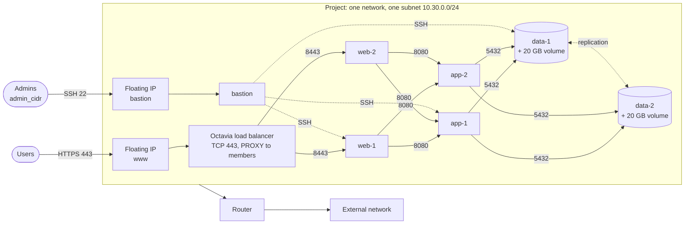

# Three-tier application with high availability

A reference layout for a web application in a single OpenStack project, with a member role only: a load balancer in front of a web tier, an application tier, a replicated data tier, and a bastion for administration.



Server groups: `web` and `app` use soft anti-affinity, `data` uses hard anti-affinity.

## What it shows

| Concern | How it is handled |
|---------|-------------------|
| Isolation between tiers | One security group per tier. Each tier accepts traffic only from the group of the tier above it (`remote_group`), not from an address range. Adding an instance to a tier needs no rule change. |
| Administration | SSH reaches the bastion only from `admin_cidr`. Other instances accept SSH only from the `bastion` group. Only the bastion and the load balancer have a floating IP. |
| Availability | Two instances per tier, spread over compute hosts by server groups. The load balancer checks the web members with a TCP health monitor. |
| Data | Each data instance has its own volume, formatted only when empty and mounted at every boot by `modules/cloudinit`. Rebuilding an instance keeps the volume. |
| Hand-off to configuration | The `inventory` output groups private addresses by tier label, ready for an Ansible inventory or another configuration tool. The module installs no application. |
| Clouds without DNSaaS | `zone_name = null` removes every DNS record. The rest is unchanged. |

## Decisions and trade-offs

**One subnet, segmented by security groups.** Tiers share a subnet and are isolated by security groups, which Neutron enforces on each port. A subnet per tier would add routing between subnets for no extra isolation, and the composite attaches one internal subnet per router (see [Known limitations](../../docs/architecture.md#known-limitations)). Use several subnets when a network appliance must inspect traffic between tiers, or when tiers belong to different teams.

**TLS ends on the web tier.** The listener is plain TCP and the pool uses the PROXY protocol, so web servers get the client address and hold the certificates. Ending TLS on the load balancer needs Barbican (`TERMINATED_HTTPS`), which many clouds do not offer to members.

**Web tier rule from the subnet range.** The amphora reaches members from its own address in the member subnet, not from the VIP port, so a `remote_group = "lb"` rule would never match. The web group therefore accepts port 8443 from the subnet range. The other tiers do not listen on 8443. On a cloud that publishes the amphora subnet, restrict the rule to it.

**Hard anti-affinity only where losing two replicas loses data.** With `anti-affinity`, Nova refuses to schedule a data instance when no free host remains: deployment fails rather than putting both copies on one host. The stateless tiers use `soft-anti-affinity`, which spreads instances when it can and still schedules them on a small cloud. Server group policies cannot change after creation: changing one replaces the group and its instances.

**Two of everything, one bastion.** The bastion is not redundant: losing it stops administration, not the service. Rebuild it with `-replace` when needed.

**Replication is the application's job.** The module opens port 5432 between data instances and gives each one a volume. Choosing and configuring the replication (PostgreSQL streaming replication, Patroni, Galera) belongs to the configuration layer.

## Run it

```bash
cat > terraform.tfvars <<'TFVARS'
external_network = "public"
az               = "nova"
image            = "ubuntu-24.04"
flavor           = "m1.small"
ssh_public_key   = "ssh-ed25519 AAAA... ops"
admin_cidr       = "203.0.113.0/24"
zone_name        = null   # or "example.org." when the project owns the zone
TFVARS

tofu init
tofu apply
ssh -J ops@$(tofu output -raw bastion) ops@<private address from the inventory output>
```

The example needs quota for 7 instances, 2 data volumes, 7 security groups, 2 server groups, 1 load balancer and 2 floating IPs.

`terraform` works the same way in place of `tofu`.
